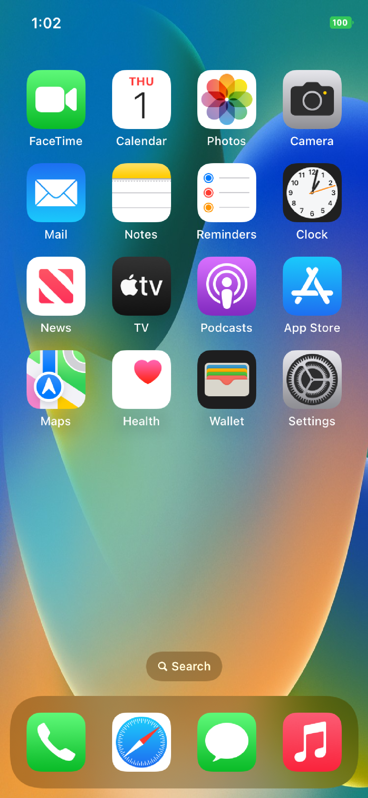
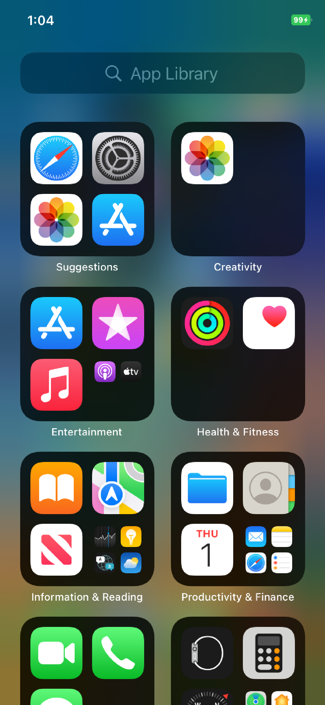
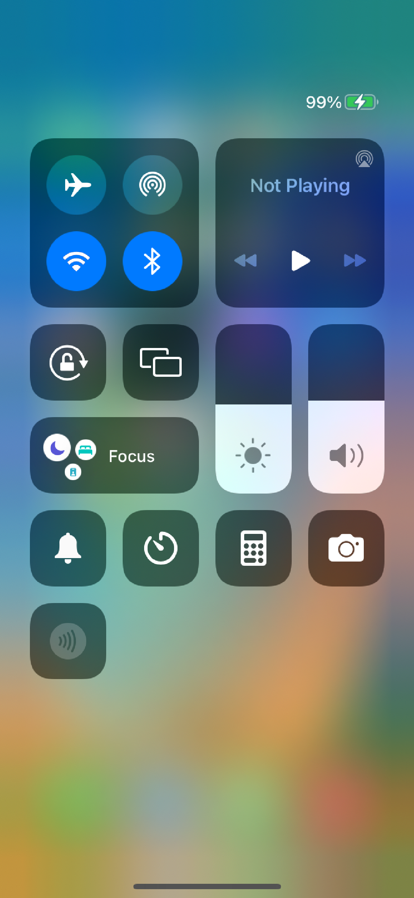
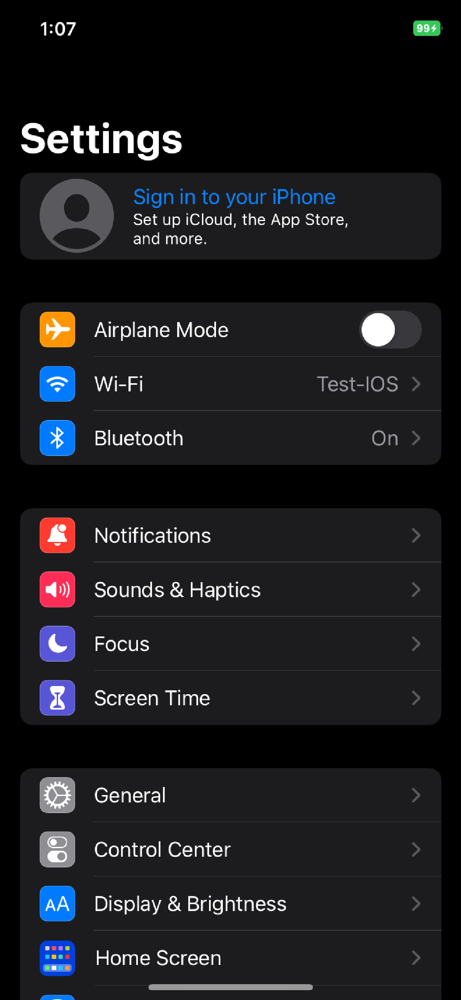

# iOS 16.5 for Xiaomi Redmi Note 9 (`merlinx`)

**Apple Darwin/XNU (`xnu-8796.121.2`) + iOS 16.5 userland with compatibility shims running natively on the Xiaomi Redmi Note 9 (`merlinx`, MediaTek Helio G85 MT6768).**

Based on [HakiOS](https://github.com/oosexgang/hakios-xnu-kernel), this port runs full iOS 16.5 (`launchd` → `backboardd` → `SpringBoard` → apps) with experimental Mali graphics, Wi-Fi, Bluetooth, persistent `ext2` storage, and USB `usbmuxd`/`libimobiledevice` support. The installer detects **3 GB / 4 GB RAM** and **64 GB / 128 GB eMMC** layouts; features and stability can vary between devices.

> [Install Guide](docs/merlinx-install.md) · [Bring-up Notes](docs/merlinx-bringup-notes.md) · [TWRP Installer](tools/install-merlinx.sh) · [Upstream Docs](docs/README.md)

---

## Screenshots

Captured directly from a Redmi Note 9 (`merlinx`) over USB using `idevicescreenshot`:

| Home Screen | App Library | Control Center | Settings |
|:---:|:---:|:---:|:---:|
|  |  |  |  |

---

## Hardware & Feature Support

This is an experimental port. The following describes what has been observed on a Merlinx, not a guarantee for every hardware variant.

| Subsystem | Status | Details |
|---|---|---|
| **Boot & CPU** | Working | iOS boots on the tested device with eight CPU cores. The loader detects supported RAM and storage sizes. |
| **Graphics & UI** | Partial | Mali-G52 acceleration and the home screen work on the tested device. A tester reported a black home screen and CoreGraphics errors; that issue is under investigation. |
| **Touch & buttons** | Working | Touch, power, and volume buttons work on the tested device. |
| **Storage & Files** | Partial | The system uses a read-only system partition and a persistent `ext2` data partition. About opens, but free-space reporting is incorrect; Files opens, but Browse may have no locations. |
| **Wi-Fi** | Working | Wi-Fi scanning and connection have been tested, including a WPA2 network. |
| **Bluetooth** | Partial | Bluetooth can be enabled and its settings open. Pairing, profiles, and audio are not fully verified. |
| **USB** | Partial | `usbmuxd`/`libimobiledevice` support provides device information, screenshots, logs, and restart on the tested setup. Some USB services remain unavailable. |
| **Wallpaper** | Partial | A static wallpaper and picker are available. An original fallback is included if optional wallpaper-generation tools are missing. Live PosterBoard wallpapers are not supported. |
| **Camera** | Partial | Rear-camera preview is available but can be slow or tear. Photo saving needs further testing. |
| **Battery** | Partial | Battery readings are exposed, but the reported percentage can be inaccurate and the charger is not controlled by the current driver. |

### Known Limitations

- **Charging:** The phone may discharge while connected to USB. The charger driver is not implemented; charge outside this build and do not rely on the displayed percentage alone.
- **Screen off:** The screen content turns black, but the physical backlight may remain on.
- **Clock:** The phone has no RTC driver yet, so its date may start at the Unix epoch. Network time may correct it once connectivity is available.
- **Storage:** Free-space and iPhone Storage readings may be incorrect; Files → Browse may show no locations. Photo saving is not yet confirmed.
- **Graphics:** Some devices have shown a black home screen and invalid CoreGraphics-context errors. Safari/WebKit rendering remains unreliable.
- **Not yet supported:** Front camera, speaker and microphone audio, cellular/baseband, `ext4` for `iosdata`, Apple online services, and additional USB services such as `afcd`, `os_trace_relay`, and `mobile_installation_proxy`.
- **QEMU:** Experimental; iOS services start, but an interactive home screen has not been verified on the current build.

---

## Install

> [!WARNING]
> Installing HakiOS on `merlinx` **replaces Android's `super`, `cache`, and `userdata`** with `xnusys` (4.0 GiB) + `iosdata` (`ext2`). **All data on the phone will be erased.** TWRP in `recovery` is preserved.

### Requirements
- **Phone:** Xiaomi Redmi Note 9 (`merlinx`, 3 GB / 4 GB RAM, 64 GB / 128 GB eMMC) with an **unlocked bootloader** and **custom recovery with root ADB** (TWRP, OrangeFox, PitchBlack, SHRP, etc.).
- **PC:** Linux `x86_64` with **~18–20 GB free disk space** during build (the installer can optionally remove extracted iOS files afterwards) and a USB cable.
- **Signing:** `ldid` in the standard Theos Linux toolchain or on `PATH`. Alternatively, set `LDID` to a compatible signing executable. It signs the keybag helper required for boot.

The installer shows download progress, completed flash chunks, and elapsed time for builds. Detailed command output is saved in `.setup-logs/`; the menu displays the combined session log path, and individual build and flash logs are kept there as well.

When an update changes files on the system image, choose **Update System and Boot**. It rebuilds and flashes `xnusys` and the boot image while preserving `iosdata`; it may need to download and extract the iOS filesystem again.

### Step-by-Step
1. **Clone the repository:**
   ```bash
   git clone -b mtk https://github.com/Yousef13710/IOS-for-Merlinx.git
   cd IOS-for-Merlinx
   ```
2. **Boot your phone into Recovery** (hold **Vol+ + Power**), connect it to your PC via USB, and confirm ADB sees it:
   ```bash
   adb devices
   ```
   *(It should show `<serial> recovery`. In TWRP/OrangeFox, make sure ADB is enabled.)*
3. **Run the installer:**
   ```bash
   ./setup-merlinx.sh
   ```
   - Choose **`1) Full Install`** and type **`YES`** when prompted.
   - The script automatically checks/guides you on host tools (Theos + `iPhoneOS16.5.sdk`, `clang`, `python3`, etc.), downloads the required iOS 16.5 (20F66) components from Apple, builds XNU + Mesa Panfrost + userland, packs `boot-ios.img`, auto-detects your 64 GB / 128 GB eMMC layout, formats `ext2`, and flashes everything.
   - At the end, it asks if you want to **clean up ~8 GB** of temporary iOS/build files (`y`) or keep them (`N`) for faster future rebuilds.
4. **Allow several minutes for the first boot:** The phone reboots into `mtkloader` → XNU → iOS 16.5.

For manual build/flash commands and troubleshooting, see **[docs/merlinx-install.md](docs/merlinx-install.md)**.

> [!TIP]
> Always use `idevicediagnostics restart` over USB for clean reboots instead of holding Power/Volume keys so the persistent `ext2` (`iosdata`) filesystem stays clean.

---

## Repositories & Legal

- **[IOS-for-Merlinx](https://github.com/Yousef13710/IOS-for-Merlinx)** — Redmi Note 9 (`merlinx`) port (`mtk` branch)
- **[hakios-xnu-kernel](https://github.com/oosexgang/hakios-xnu-kernel)** — Upstream HakiOS repository (`X6826B`)

The repository includes CONNSYS radio firmware under `firmware/connsys`; these vendor files are separate from the project's own code. Apple binaries are not included (`./ios165/fetch.sh` downloads required files from Apple’s official IPSW during setup). XNU patches are under the **Apple Public Source License 2.0**; original loader, driver, and userland code is under **MIT**. Not affiliated with or endorsed by Apple.

---

## Support the Project

If this project helped you or you'd like to support further `merlinx` development:

- **USDC (Solana network · Phantom):** `77Rcq3eVp1vHVyBNgyB4zGGPwbJGa9C5wek5L4MMBsgy`
